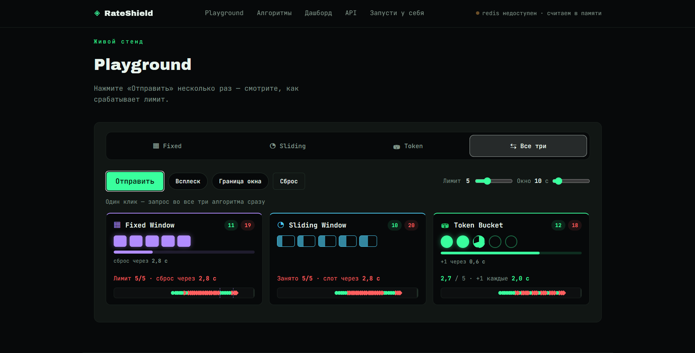

<p align="center">
  
</p>

<h1 align="center">RateShield</h1>

<p align="center">
  <b>Self-hosted rate limiter для API</b> — три алгоритма на атомарных Lua-скриптах Redis,<br>
  три способа подключения к вашему продукту и живой плейграунд, где алгоритмы можно сравнить вживую.
</p>

<p align="center">
  
  
  
  
</p>



## Содержание

1. [О сервисе](#о-сервисе)
2. [Возможности](#возможности)
3. [Три алгоритма](#три-алгоритма)
4. [Playground: как смотреть демо](#playground-как-смотреть-демо)
5. [Быстрый старт](#быстрый-старт)
6. [Подключение к своему продукту](#подключение-к-своему-продукту)
7. [Redis и надёжность](#redis-и-надёжность)
8. [Бесплатный хостинг демо (Render + Upstash)](#бесплатный-хостинг-демо-render--upstash)
9. [Свой сервер / VPS](#свой-сервер--vps)
10. [Безопасность](#безопасность)
11. [Конфигурация (переменные окружения)](#конфигурация-переменные-окружения)
12. [Разработка и тесты](#разработка-и-тесты)
13. [Ограничения](#ограничения)
14. [Структура проекта](#структура-проекта)

---

## О сервисе

RateShield ограничивает частоту запросов к вашему API: защищает логин от перебора, публичные ручки от скрейпинга, платные операции от злоупотреблений и сам сервис от перегрузки. Один и тот же код работает двумя способами:

- **Демо-режим** (`MODE=demo`) — лендинг c интерактивным плейграундом.
- **Рабочий режим** (`MODE=proxy`, плюс middleware и HTTP API) — реальное лимитирование запросов к вашему продукту на вашем сервере или VPS.

## Возможности

- **Три алгоритма:** Fixed Window, Sliding Window, Token Bucket — выбираются под задачу, в том числе по правилам для разных путей.
- **Атомарность.** Все проверки в Redis выполняются Lua-скриптами: никаких гонок между параллельными запросами и инстансами. В тестах 300 одновременных запросов при лимите 50 пропускают ровно 50.
- **Три способа подключения:** reverse proxy без изменений в коде продукта, Express-middleware и язык-независимый HTTP API.
- **Правила на JSON:** лимит, окно и алгоритм по методу и пути (`POST /auth/login`, `/api/*`), ключ по IP или заголовку (`X-API-Key`), исключения. Перечитываются без рестарта по `SIGHUP`.
- **Поведение при сбое Redis** задаётся явно: `FAIL_MODE=open` (пропускать) или `closed` (отвечать 503). Сервис сам переподключается; в логе одна запись на сбой, а не поток повторов.
- **Playground** с режимом сравнения: один и тот же поток запросов идёт на все три алгоритма, и у каждого своя живая визуализация состояния.
- **Дашборд** использования: принято и отклонено по алгоритмам и источникам, доля блокировок, лента последних решений.
- **Безопасные умолчания:** служебные эндпоинты существуют только при `ADMIN_TOKEN`, IP из `X-Forwarded-For` берётся только от доверенных прокси, правила нельзя обойти сменой написания пути.
- **Стандартные заголовки:** `X-RateLimit-Limit`, `X-RateLimit-Remaining`, `X-RateLimit-Reset`, `Retry-After`.
- **Docker, Render, systemd:** готовые `Dockerfile`, `docker-compose.yml`, `render.yaml`.

## Три алгоритма

|                       | Fixed Window                                     | Sliding Window                            | Token Bucket                                            |
| --------------------- | ------------------------------------------------ | ----------------------------------------- | ------------------------------------------------------- |
| Идея                  | Счётчик на окно, по окончании обнуляется целиком | Журнал запросов: каждый живёт своё окно   | Токены капают в бакет непрерывно, запрос забирает один  |
| Всплеск на стыке окон | **до ~2× лимита**                                | нет, лимит держится в любом промежутке    | ограничен ёмкостью бакета                               |
| Короткий всплеск      | да, до лимита                                    | да, до лимита                             | **да, и это штатное поведение**                         |
| Как разблокируется    | разом, когда окно закончилось                    | слот за слотом, по мере старения запросов | по одному токену, в темпе пополнения                    |
| Память на ключ        | минимальная                                      | выше (запись на каждый запрос)            | минимальная                                             |
| Подходит для          | грубой защиты, дешёвых счётчиков                 | точного лимита (логин, платные операции)  | API с «рваным» трафиком, равномерной нагрузки на бэкенд |

Отклонённые запросы в Sliding Window в журнал не попадают: клиент, который продолжает стучаться, не продлевает собственную блокировку.

## Playground: как смотреть демо

Простой интерактив: кнопка «Отправить», ползунки лимита и окна, два сценария. Запросы идут на реальный бэкенд и считаются по IP.

**Режимы.** Один алгоритм (Fixed / Sliding / Token) или **«Все три»**: один клик — запрос сразу на все алгоритмы.

**Визуализация** обновляется в реальном времени:

| Алгоритм       | Что нарисовано                                 |
| -------------- | ---------------------------------------------- |
| Fixed Window   | Блоки-счётчик и один общий таймер окна         |
| Sliding Window | Слоты со своим таймером жизни у каждого        |
| Token Bucket   | Круглые токены, следующий наполняется по кругу |

**Сценарии:**

| Сценарий         | Что делает                                                                 |
| ---------------- | -------------------------------------------------------------------------- |
| **Всплеск**      | Много запросов подряд, потом редкие проверки — как алгоритмы «оживают»     |
| **Граница окна** | Лимит в конце окна + сразу после сброса — показывает слабость Fixed Window |

---

## Быстрый старт

```bash
git clone <ваш-репозиторий> rateshield && cd rateshield
npm install
npm start                       # демо на http://localhost:3000, Redis не нужен
```

С Redis:

```bash
REDIS_URL=redis://localhost:6379 npm start
```

Docker (сервис и Redis одной командой):

```bash
docker compose up -d
curl http://localhost:3000/_rateshield/health
```

Настройки читаются из переменных окружения или файла `.env` (скопируйте `.env.example`). Нужен Node.js 20+.

## Подключение к своему продукту

### 1. Reverse proxy (без изменений в коде продукта)

RateShield ставится перед вашим API, а правила лежат в JSON-файле.

```bash
MODE=proxy
UPSTREAM_URL=http://127.0.0.1:8080
REDIS_URL=redis://localhost:6379
RULES_FILE=./rateshield.rules.json
ADMIN_TOKEN=$(openssl rand -hex 32)
npm start
```

`rateshield.rules.json` (первое подходящее правило выигрывает, иначе применяются `defaults`):

```json
{
    "defaults": {
        "algorithm": "token",
        "limit": 120,
        "windowSec": 60,
        "key": "ip"
    },
    "rules": [
        { "name": "health", "match": "GET /health", "skip": true },
        {
            "name": "login",
            "match": "POST /auth/login",
            "algorithm": "fixed",
            "limit": 5,
            "windowSec": 60
        },
        {
            "name": "search",
            "match": "GET /api/search*",
            "algorithm": "sliding",
            "limit": 30,
            "windowSec": 60
        },
        {
            "name": "api",
            "match": "/api/*",
            "algorithm": "token",
            "limit": 600,
            "windowSec": 60,
            "key": "header:x-api-key"
        }
    ]
}
```

- `match`: `[МЕТОД] /путь`, `*` — любые символы. Регистр, `//`, `/../` и `%`-кодирование нормализуются.
- `key`: `ip` (IPv6 по подсети /64), `header:<имя>` (значение хешируется), `global`.
- Изменили файл? `kill -HUP <pid>` (или `docker kill -s HUP <контейнер>`): новые лимиты применятся без рестарта.

Заблокированный запрос получает `429` с `Retry-After` и не доходит до вашего API.

### 2. Express-middleware

```js
const { createStore, rateLimit } = require("rateshield");

const store = createStore({ url: process.env.REDIS_URL }); // пусто = in-memory
app.set("trust proxy", 1); // если за nginx / Caddy
app.use(
    "/api",
    rateLimit(store, { algorithm: "sliding", limit: 100, windowSec: 60 }),
);
```

Опции: `algorithm` (`fixed` | `sliding` | `token`), `limit`, `windowSec`, `keyGenerator(req)`, `failMode` (`open` | `closed`), `skip(req)`, `prefix`.

### 3. HTTP API решений (любой язык)

Включается заданием `ADMIN_TOKEN`. Ваш бэкенд спрашивает «можно ли?» и сам решает, что ответить клиенту.

```bash
curl -X POST https://api.example.com/_rateshield/v1/check \
  -H "Authorization: Bearer $ADMIN_TOKEN" -H "Content-Type: application/json" \
  -d '{"key":"user:42","rule":"login"}'
# {"allowed":true,"limit":5,"remaining":4,"resetIn":60,"retryAfter":0,"algorithm":"fixed-window","degraded":false}
```

```python
import os, requests

def allowed(user_id: str) -> bool:
    r = requests.post(
        "https://api.example.com/_rateshield/v1/check",
        headers={"Authorization": f"Bearer {os.environ['RATESHIELD_TOKEN']}"},
        json={"key": f"user:{user_id}", "rule": "api"},
        timeout=0.5,
    )
    return r.ok and r.json()["allowed"]
```

Тело запроса: `key` (до 256 символов) и либо `rule` (имя правила из файла), либо явные `algorithm`, `limit`, `windowSec`. Решение всегда приходит с кодом `200` в поле `allowed`.

Служебные эндпоинты (все под `/_rateshield`, не пересекаются с маршрутами продукта):

| Эндпоинт         | Доступ | Назначение                                 |
| ---------------- | ------ | ------------------------------------------ |
| `GET /health`    | открыт | состояние сервиса и хранилища (всегда 200) |
| `POST /v1/check` | токен  | решение для произвольного ключа            |
| `GET /stats`     | токен  | счётчики по алгоритмам и источникам        |
| `GET /rules`     | токен  | действующие правила                        |

---

## Redis и надёжность

**Подключение.** Подойдёт любой Redis 6+ или Valkey, в том числе управляемый (Upstash и т. п.). Для TLS указывайте `rediss://`; для Upstash TLS включится автоматически, даже если забыли вторую «s». Используются обычные команды и Lua-скрипты (`EVAL` / `EVALSHA`), никаких модулей не нужно.

**Сбой Redis.** `FAIL_MODE` определяет поведение, пока Redis недоступен (таймаут команды — `REDIS_TIMEOUT_MS`, по умолчанию 1 с):

| `FAIL_MODE`           | Поведение                                                           | Когда выбирать                                |
| --------------------- | ------------------------------------------------------------------- | --------------------------------------------- |
| `open` (по умолчанию) | запросы пропускаются, в ответ добавляется `X-RateLimit-Degraded: 1` | доступность продукта важнее строгости лимитов |
| `closed`              | ответ `503` с `Retry-After`                                         | защита логина, платных операций               |

В **демо-режиме** при недоступном Redis счётчики автоматически ведутся в памяти процесса (страница показывает «redis недоступен · считаем в памяти»), и демонстрация лимитов не ломается. Когда Redis появляется, сервис переключается на него сам. В боевом режиме молчаливого отката на память нет намеренно: счётчики перестали бы быть общими, и вы бы этого не заметили.

**Логи.** Ошибка подключения пишется **один раз за сбой**, с подсказкой о вероятной причине (`ETIMEDOUT`, `ENOTFOUND`, `WRONGPASS`, ошибка TLS и т. п.), и снова только после восстановления («Redis снова доступен»). Пароль в логи не попадает.

`/_rateshield/health` всегда отвечает 200 и показывает `"status":"degraded"` при проблемах, чтобы оркестратор не перезапускал контейнер зря.

## Свой сервер / VPS

Пошаговая инструкция вынесена в **[docs/SELF-HOSTING.md](docs/SELF-HOSTING.md)**: Docker Compose, HTTPS через Caddy, закрытие прямого доступа, запуск через systemd, правила, диагностика Redis и пример клиента на Python.

Минимальный боевой запуск:

```bash
cp .env.example .env     # MODE=proxy, UPSTREAM_URL, ADMIN_TOKEN, RULES_FILE
docker compose up -d
```

Compose поднимает сервис и Redis с постоянным хранилищем (AOF). Порт Redis наружу не публикуется.

---

## Безопасность

- **Служебные эндпоинты закрыты по умолчанию.** `/v1/check`, `/stats`, `/rules` существуют только при заданном `ADMIN_TOKEN` (не короче 16 символов); токен сравнивается в постоянное время. Публичное демо не превращается в открытый прокси.
- **IP клиента.** `X-Forwarded-For` учитывается только от доверенных прокси (`TRUST_PROXY`, по умолчанию: локальные и приватные адреса, то есть nginx/Caddy на этой же машине или в docker-сети). Клиент из интернета не может подделать IP. IPv6 считается по подсети /64.
- **Правила не обойти.** Пути нормализуются перед сопоставлением (регистр, `//`, `/../`, `%`-кодирование).
- **Секреты не попадают в Redis.** Ключи по заголовкам (`X-API-Key`) хешируются.
- **Демо ограничено сверху:** лимит до 100 и окно до 300 с, чтобы посетитель не мог забить хранилище.
- **Graceful shutdown:** по `SIGTERM` сервис закрывает соединения и Redis.

## Конфигурация (переменные окружения)

Полный список с комментариями — в [`.env.example`](.env.example). Главное:

| Переменная                                    | Назначение                                           |
| --------------------------------------------- | ---------------------------------------------------- |
| `MODE`                                        | `demo` (по умолчанию) или `proxy`                    |
| `PORT`                                        | порт (на Render подставляется автоматически)         |
| `REDIS_URL`                                   | `redis://…` / `rediss://…`; пусто — in-memory        |
| `REDIS_TIMEOUT_MS`                            | таймаут команды Redis, мс (по умолчанию 1000)        |
| `KEY_PREFIX`                                  | префикс ключей (по умолчанию `rs`)                   |
| `FAIL_MODE`                                   | `open` / `closed` при сбое Redis                     |
| `UPSTREAM_URL`                                | адрес вашего API (обязателен для `MODE=proxy`)       |
| `UPSTREAM_TIMEOUT_MS`, `PROXY_PRESERVE_HOST`  | таймаут апстрима, передавать ли исходный `Host`      |
| `RULES_FILE`                                  | JSON с правилами; `SIGHUP` перечитывает              |
| `ADMIN_TOKEN`                                 | включает `/_rateshield/v1/check`, `/stats`, `/rules` |
| `TRUST_PROXY`                                 | каким прокси доверять при определении IP             |
| `RATE_ALGORITHM`, `RATE_LIMIT`, `RATE_WINDOW` | значения по умолчанию (в demo — для плейграунда)     |

## Разработка и тесты

```bash
npm run dev                                           # запуск с перезагрузкой при правках
npm test                                              # тесты на in-memory хранилище
TEST_REDIS_URL=redis://127.0.0.1:6379 npm test        # те же проверки на реальном Redis
npm run load-test                                     # нагрузочный скрипт (нужен запущенный сервис)
```

Тесты покрывают алгоритмы (одинаковый набор на памяти и на Redis, включая атомарность), нормализацию путей и IP, режим proxy (проксирование, 429, 502/504, обход правил), HTTP API проверки, демо-эндпоинты, откат демо на память и поведение логов при сбое.

## Ограничения

- **WebSocket / Upgrade** через режим proxy не проксируются.
- **Одно правило на запрос.** Составные условия (например, и по IP, и по ключу одновременно) пока не поддерживаются.
- **Ключ по заголовку** надёжен, только если ваш API отвергает неизвестные значения заголовка; иначе можно присылать случайные значения и получать свежий счётчик. Для публичных неаутентифицированных ручек используйте `ip`.
- **Статистика** (`/stats`, дашборд) хранится в памяти процесса и обнуляется при рестарте; при нескольких инстансах у каждого своя.
- **Часы.** Время для Sliding Window и Token Bucket берётся на стороне сервиса RateShield; при нескольких инстансах синхронизируйте часы (chrony / NTP).
- Лимиты считаются по числу запросов, а не по размеру тела.
- Файлы `Dockerfile` и `docker-compose.yml` не запускались в среде разработки этого релиза: проверьте первый запуск.

## Структура проекта

```
rateshield/
├── server.js                    # точка входа: конфиг, хранилище, запуск, graceful shutdown
├── src/
│   ├── app.js                   # сборка Express-приложения (demo / proxy, /_rateshield)
│   ├── index.js                 # публичный API библиотеки: createStore, rateLimit, ...
│   ├── config/                  # env.js (переменные), rules.js (правила), store.js (Redis + Lua, in-memory)
│   ├── limiters/                # fixedWindow, slidingWindow, tokenBucket
│   ├── core/                    # enforce.js (решение + FAIL_MODE), identity.js (IP, пути, ключи)
│   ├── middleware/              # rateLimit.js (Express), adminAuth.js
│   ├── proxy/gateway.js         # reverse proxy с лимитами
│   ├── routes/                  # demo.js (плейграунд), check.js (HTTP API решений)
│   ├── store/stats.js           # статистика для дашборда
│   └── utils/logger.js          # JSON-логи, «одна запись на сбой»
├── public/                      # лендинг, плейграунд (playground.js), дашборд, фавикон
├── tests/                       # unit и интеграционные тесты, нагрузочный скрипт
├── docs/                        # SELF-HOSTING.md и скриншоты
├── rateshield.rules.example.json
├── .env.example
├── Dockerfile
├── docker-compose.yml           # сервис + Redis (AOF)
└── render.yaml                  # Render Blueprint
```

---

<p align="center">
  Node.js · Express · ioredis · Lua · MIT
</p>
